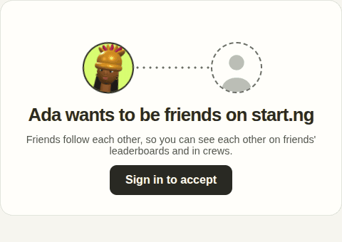

# start.ng friend invite: whimsy demo

An HNG15 (Week 5) design demo of start.ng's friend invite page. **Mock data only**: no backend, no API calls.

The UI, styles, top bar, theme toggle, character code and 3D face snapshots are copied from
[`Cybertron-HNG/startng-fe`](https://github.com/Cybertron-HNG/startng-fe), which was used read-only as the source.
Nothing here is a change to that repo. The first design is in [`INVITE_SPEC.md`](./INVITE_SPEC.md); the accept
animation was then settled in [`accept-reference.html`](./accept-reference.html) (the "Squish hug + selfie" card).

**Live demo: https://startng-invite.vercel.app**



## The idea

When someone sends you an invite, their character is waiting with a seat saved next to them. Tap **Accept** and the
two of you meet in the middle and take a photo together.

- **Page opens: calm.** Ada pops in and waves once, the dotted line draws to your seat (under a second).
- **Accept: the "Squish hug + selfie".** You both lean back (170ms), rush together (230ms) and squash on contact with a
  small lime burst, then tilt in. A camera flash, and a polaroid drops in behind the two of you
  (caption "Ada + 99plusOne · today's date"). The faces lift into the photo and a "+1 friend" chip pops on its top edge.
  Plays once, nothing loops.
- Built with the Web Animations API on nested wrappers per face (x, y, scale), following the reference's `combo` block
  step for step: `src/invite/accept.ts`.
- Motion is transform, opacity and `stroke-dashoffset` only.
- **Reduced motion** (the system setting, or the demo's "Preview reduced motion") jumps straight to the final polaroid.

## What changed from the real invite page

The real page's words and states are kept; these are the differences.

**New copy**

| State | Heading | Note | Button / link |
| --- | --- | --- | --- |
| Guest | Ada saved you a seat | Accept and you'll follow each other. You'll see each other on friends' leaderboards and can play in the same crews. | Sign in to accept |
| Signed in | Ada saved you a seat | (same) | Accept, then "Accepting..." while it works |
| Accepted | You and Ada are friends | You follow each other now. Look for Ada on the friends board next time you play. | See your friends (link) |
| Own link | This is your invite link | Send it to a friend. Whoever accepts takes the empty seat and becomes your friend. | Copy link, then "Copied" for 2s |
| Expired | This invite has expired | Invite links only last a while. Ask your friend to send a new one, or get your own link to share. | "get your own link" (link) |

**The heading fix.** The real page shows "Ada wants to be friends on start.ng" to Ada herself when she opens her own
link, because it only checks whether the invite was accepted. The own-link state now has its own heading.

**The one new button: Copy link** (a ghost button on the own-link state). The real page has no such button there; it
lets the empty seat nudge when tapped.

**The expired picture shows no inviter.** start.ng's API sends nothing about the inviter for a dead link, so there is
no face or name: two empty dashed seats, a small static "z" on each, and the dotted line broken in the middle.

## Routes

- `/f/demo1234`: the invite (`/` and unknown paths go here)
- `/f/expired1`: the expired link

Demo controls above the card: **View as** Guest, Signed in, Inviter (own link) · **Expired link** · **Replay** · **Preview reduced motion**.
In the Guest view, "Sign in to accept" signs you in (mock) so you can walk the whole story.

## Run it

```bash
npm install
npm run dev
npx tsc --noEmit && npm run build
```

Vite + React 18 + TypeScript + `three` 0.185.1 (the same versions as startng-fe). Plain CSS, no UI library.

## Where things are

- `src/invite/accept.ts`: the accept sequence (Web Animations API)
- `src/invite/Bench.tsx`, `src/invite/invite.css`: the stage, the seats, the line, the polaroid and the opening
- `src/invite/InvitePage.tsx`: the page (starting point: startng-fe's `InvitePage.tsx`)
- `src/mock.ts`: Ada, you, and the accept call (400ms)
- `src/Avatar.tsx`: startng-fe's `AvatarFace` plus a size left to CSS. start.ng's `.avatar` circle (lime, first letter) shows at once and fades out when the face is ready (or stays, if WebGL fails). `three/snapshot` starts loading in `src/main.tsx`
